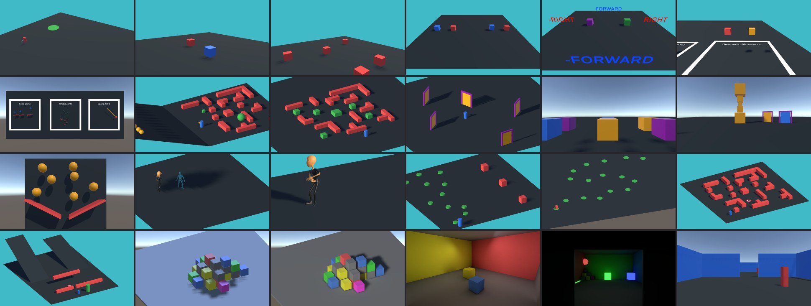

# Unity-Course-Lectures

Unity educational material for the Virtual Reality course held @ Politecnico di Torino.

> [!WARNING]
> **This repository is under heavy maintenance.** The course is receiving a major update throughout this year, so things may break or not work as expected. Apologies for the inconvenience!
> If you run into a problem, please [open an issue](https://github.com/francescoStrada/Unity-Course-Lectures/issues/new): it lets me know what to fix and it is very much appreciated.

## Documentation

Lecture notes and explanations of the project material are available on the course site:

**https://francescostrada.github.io/Unity-Course-Lectures/**

## The Project

The Unity project is in the [`Unity-Course-Lectures/`](Unity-Course-Lectures) folder. It targets **Unity 6.3** (6000.3.27f1) with the **Universal Render Pipeline (URP)**. The Scripting material (ES03) also uses the new **Input System**; the other topics are being updated in turn.

## Branches

- `main`: stable version of the material
- `develop`: ongoing work
- `6.3-update`: upgrade of the project to Unity 6.3

## Contributing

Found a bug? Please [open an issue](https://github.com/francescoStrada/Unity-Course-Lectures/issues/new). If you have a fix or an improvement, feel free to fork the repository and open a pull request.
