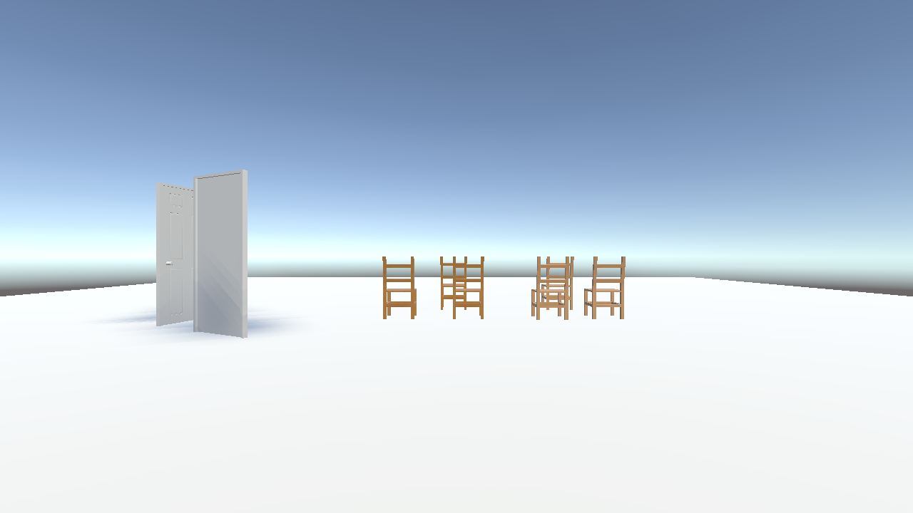
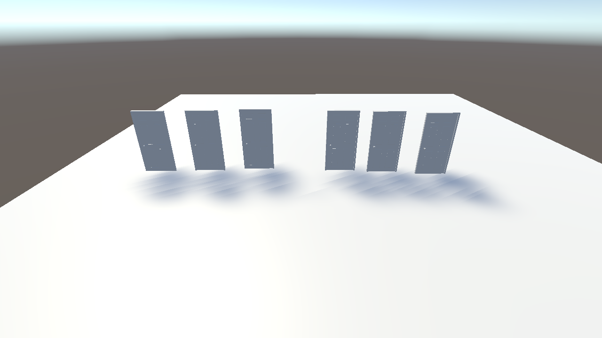
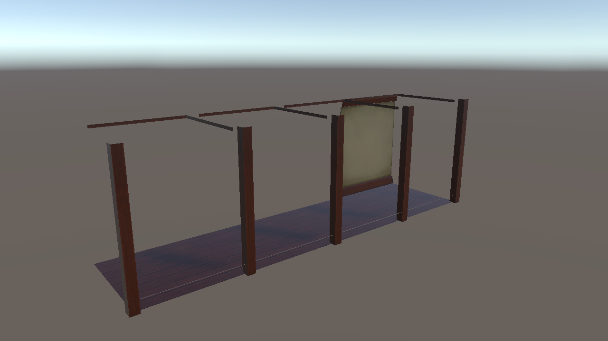
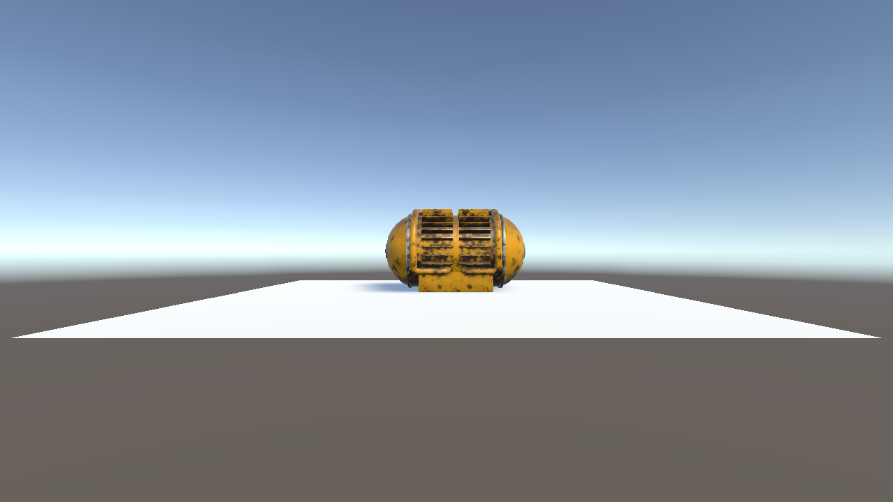
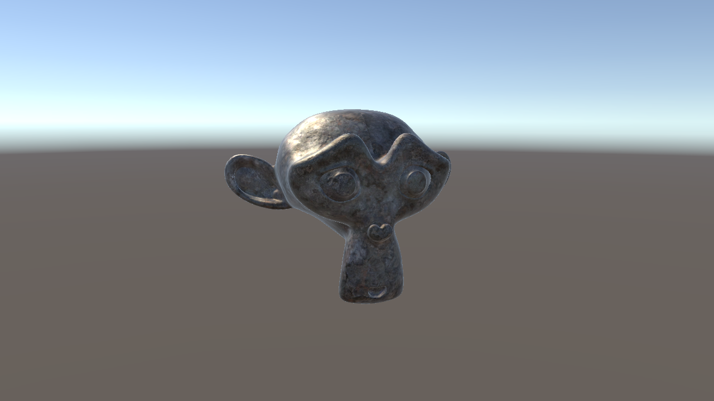

# 3D Assets

An introduction to the main concepts associated with 3D assets, from modeling and exporting in Blender to importing them in Unity, is covered in [this](https://youtube.com/playlist?list=PLk0p6RIhmcfnc-5eepTpb2BA_cqBQDrJB) YouTube playlist.

On this page, you can find an overview of the [Blender material](#blender-material) and of the [project contents](#project-material) seen in the videos.

> **Note:** the videos were recorded with Unity 2019.4 and the Built-in Render Pipeline, while the project now targets **Unity 6.3** and the **Universal Render Pipeline (URP)**. The scenes, prefabs and assets keep the names used in the videos; the materials were converted to the URP *Lit* shader, and every scene stores its ambient lighting (**Window > Rendering > Lighting > Generate Lighting**), so that the skybox keeps lighting the objects as it did in the Built-in pipeline.

## Blender Material

The Blender files used in the videos are in the [`Blender/`](https://github.com/francescoStrada/Unity-Course-Lectures/tree/main/Blender) folder at the root of the repository, next to the Unity project (and not inside it, so that Unity does not import them).

- `VR_ES02_3DAssets.blend`: the main Blender file, with the objects shown in the videos.
- `exports/`: the FBX files exported from Blender, which are the ones imported in Unity (`handles_batch/` contains a set of objects exported in one go).
- `textures/`: the PBR texture sets used by the materials (base color, normal, roughness/metalness, ambient occlusion, displacement).

Keep the folder structure unchanged when opening the `.blend` file, since the textures are referenced with relative paths.

<blockquote class="callout callout_default" theme="">

The <b>buildings kit</b> used in the videos is a third-party Blender asset pack downloaded from the internet, and its original source is unknown. For this reason, and because of its size, it is <b>not included</b> in the repository. It is not needed to run any of the Unity scenes.
 </blockquote>

## Project Material

All the videos refer to scenes, prefabs and models contained in the "Assets/\_3DAssets" folder.

- [3DAssets](#3dassets)
- [Doors](#doors)
- [Corridor](#corridor)
- [BatteryPack](#batterypack)
- [TextureMaps](#texturemaps)

All the models were imported with the default settings of the Unity [Model Importer](https://docs.unity3d.com/Manual/FBXImporter-Model.html). Whenever you bring an asset from Blender, check at least the following properties in the **Model** tab of the Inspector: **Scale Factor** (and *Convert Units*), **Normals** and **Tangents**, **Read/Write** and **Mesh Compression** (both affect memory), **Generate Lightmap UVs** (only if the object uses baked lighting) and the **Materials** import mode.

### 3DAssets

This is an overview scene collecting the different assets exported from Blender:

- **Doors**: a joined door (`door_joined`) and the two openable doors (`openable_door_v1` and `openable_door_v2`), explained in the [Doors](#doors) scene.
- **Chairs**: the `chair_base_origin` model, instantiated through two prefabs (`chair_base_origin_wood_1` and `chair_base_origin_wood_2`) which differ only in the material (`wood_1` and `wood_2`). The same mesh is reused with different textures, without duplicating any geometry. Its origin is at the base of the legs, so the chair sits on the floor when placed at height 0. The `chair` model is also available in the project, to compare how the position of the origin changes the way an object is placed.

### Doors

This scene compares the different ways of exporting the same door from Blender. On the left, three `door_joined` instances; on the right, three `openable_door_v1` instances.

- **Joined door**: `door_joined.fbx` exports door, frame and handle as a *single mesh* (1192 triangles). It is cheap to render, but it cannot be animated in parts: the handle cannot be turned and the door cannot be opened.
- **Separated door**: `door_separated.fbx` keeps door, frame and handle as *different objects*. In the `openable_door` prefabs they are organized in a hierarchy: the root of the prefab is positioned on the **hinge** of the door, the `Door` child is shifted by half of its width, and the handle is a child of the door. As a consequence, rotating the root around the Y axis opens the door around its hinge. This is the reason why the **pivot** (origin) of the objects must be set in Blender before exporting.
- **Handle variants**: `openable_door_v1` uses the `Door_Handle` mesh (240 triangles), whereas `openable_door_v2` uses `door_handle_back` (1104 triangles), a different and more detailed handle model. The folder `Blender/exports/handles_batch` collects several handle models exported in one go from Blender.

### Corridor

This scene shows how to build an environment out of **modular pieces**. The `corridor` prefab is made of a floor, a ceiling, a wall and a column (`corridor_elements.fbx`), and it is repeated four times to build the whole corridor. The `corridor_double_side` prefab adds a second wall on the opposite side, so that both sides of the corridor are closed.

Take a look at the scene from the opposite side, or at the missing walls in the picture above: the walls are *planes* rendered on **one side only**. Unity does not draw the *back face* of a polygon (back-face culling), and which side is the front is decided by the **normals** of the mesh, defined in Blender. If a face looks invisible or inverted after the import, the first thing to check are the normals (in Blender, *Face Orientation* overlay) before trying anything else.

The materials (`houseTileFloor01`, `houseTileCeiling01`, `houseTileColumn01`, `houseWall01`) are reused among the pieces, and the textures are in the `Models/HouseElements/Textures` folder.

### BatteryPack

This scene shows a high-detail model with its **Levels Of Detail (LOD)**. The `battery_pack` prefab has a [LOD Group](https://docs.unity3d.com/Manual/class-LODGroup.html) with four meshes exported from Blender in the same FBX (named with the `_LOD0`, `_LOD1`, `_LOD2`, `_LOD3` suffixes, which Unity recognizes automatically):

| LOD | Triangles | Object height on screen |
| --- | --- | --- |
| LOD0 | 12468 | above 25% |
| LOD1 | 7480 | 12.5% - 25% |
| LOD2 | 3740 | 6.25% - 12.5% |
| LOD3 | 1246 | 1% - 6.25% |

Below 1% the object is culled and not rendered at all.

Select the object and move the camera in the **Scene** view away from it to see the LOD changing: the farther the camera, the simpler the mesh that is rendered. All the LODs share the same material (`BatteryPack.001`), so the change is almost invisible but the rendering cost decreases significantly.

The model comes with a complete set of PBR maps (base color, normal, metallic, roughness, height, emissive), available in the `Blender/textures/BatteryPack` folder.

### TextureMaps

The classic Blender monkey (`suzane`) with a corroded metal material (`metal_corroded`), to show what each **texture map** contributes to the final look of the surface. The material uses the URP [Lit](https://docs.unity3d.com/Packages/com.unity.render-pipelines.universal@17.0/manual/lit-shader.html) shader with:

- **Base Map**: the color of the surface (`..._COL_2K_METALNESS`).
- **Normal Map**: the small relief of the surface, simulated through the lighting without adding any geometry (`..._NRM_2K_METALNESS`). Remember to set its texture type to *Normal map* in the importer.
- **Metallic Map**: the combined roughness/metalness texture (`..._COMBINE_R_M`), which tells the shader which areas behave like a metal and how rough they are.

Try to disable each map in the material, one at a time, to see its contribution. Only three of the texture sets available in `Blender/textures/MetalCorrodedHeavy001` (which also contains ambient occlusion, displacement, roughness and metalness separately) are imported in Unity: import only the maps you really use, since textures are the heaviest part of the assets in memory.
