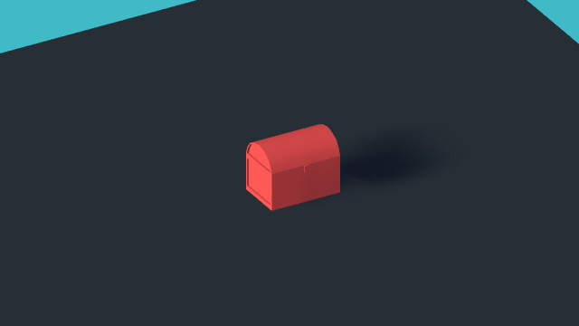
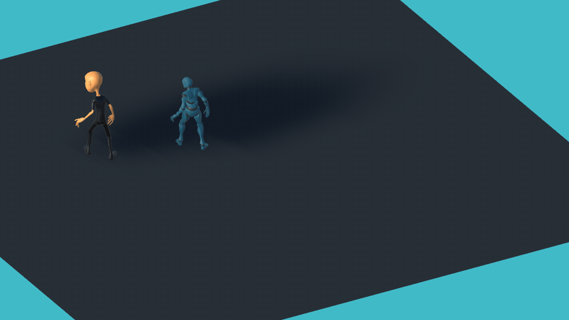
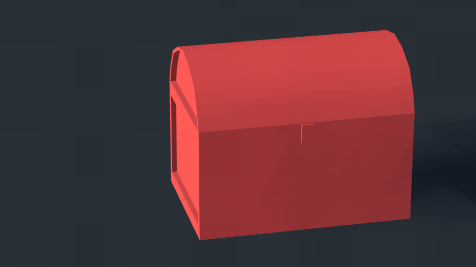
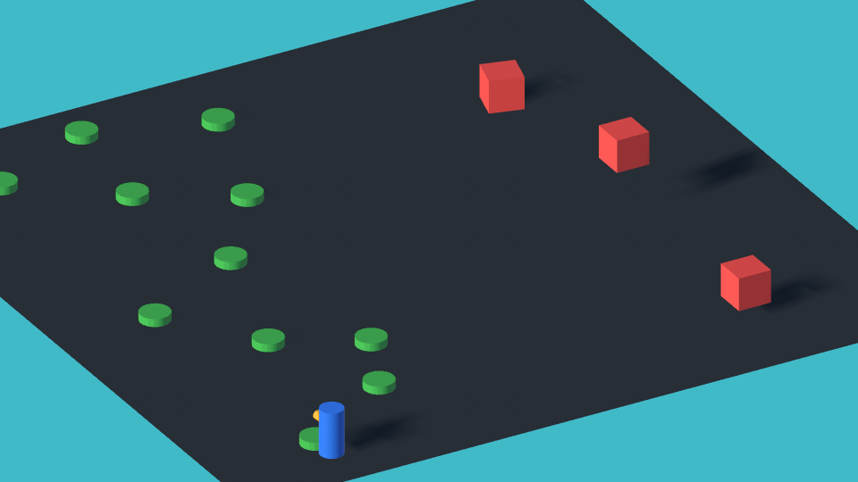
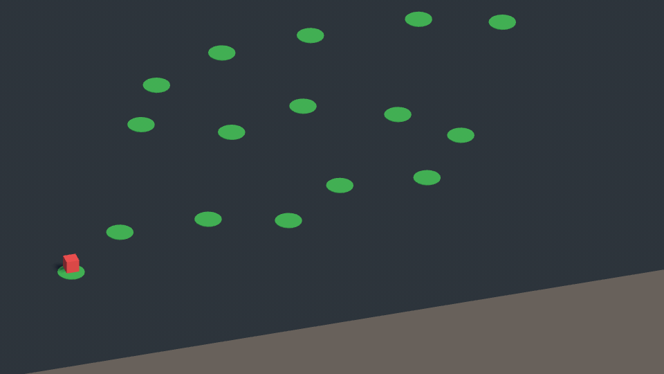

# Animations

An introduction to the main concepts associated with animations in Unity are covered in [this](https://youtube.com/playlist?list=PLk0p6RIhmcfn7cVwDWtoLBl7eFoiMqfN9) YouTube playlist.

In this page you can find an overview of the [project contents](#project-material).

> **Note:** as for the [Scripting](../scripting/) material, the scripts now use the new Input System, and every replaced line of the legacy `Input` class is kept as a comment directly above its new version.

## Project Material

All the videos refer to scenes and scripts contained in the "Assets/\_Animations" folder.

- [00-Simple-Animations](#00-simple-animations)
- [01-Character-Animations](#01-character-animations)
- [02-Timeline](#02-timeline)
- [03-DOTween](#03-dotween)
- [04-Coroutines](#04-coroutines)

### 00-Simple-Animations



This scene shows the basic building blocks of the Unity [animation system](https://docs.unity3d.com/Manual/AnimationOverview.html) on a simple object: a treasure chest. Press Play, click inside the Game view and press **O** to open the chest and **C** to close it.

The opening movement of the lid is an **Animation Clip** (*treasure_chest_opener*), created with the [Animation window](https://docs.unity3d.com/Manual/animeditor-UsingAnimationEditor.html) by recording the rotation of the lid over time. The clip is played by the [Animator](https://docs.unity3d.com/Manual/class-Animator.html) component of the chest, following the [Animator Controller](https://docs.unity3d.com/Manual/class-AnimatorController.html) *treasure_chest*, a [state machine](https://docs.unity3d.com/Manual/AnimationStateMachines.html) with three states:

- **New State**: the default empty state, the chest is closed;
- **treasure_chest_opener**: plays the clip, opening the lid;
- **treasure_chest_opener (Reverse)**: plays the same clip with *Speed* set to -1, i.e., backwards, closing the lid. There is no need to animate the closing separately.

The transitions between the states are driven by a Bool [parameter](https://docs.unity3d.com/Manual/AnimationParameters.html) named *open*, which the *TreasureChestOpener.cs* script sets from the keyboard input with [SetBool()](https://docs.unity3d.com/ScriptReference/Animator.SetBool.html):

```csharp
public void Open()
{
    if (_animator == null)
        return;

    _open = true;

    _animator.SetBool("open", _open);
}
```

The script never plays a clip directly: it only changes the value of a parameter, and the Animator Controller decides which state, and therefore which clip, is played.

### 01-Character-Animations



The same approach is applied to animated characters. The two humanoid characters of the scene were downloaded from [Mixamo](https://www.mixamo.com/), together with their *Idle*, *Walking* and *Death* animations, and imported as [Humanoid](https://docs.unity3d.com/Manual/AvatarCreationandSetup.html) models. Since they share the same humanoid structure, both use the same Animator Controller (*humanoidMixamoController*).

Press Play and move them with the **WASD** keys; hold **Z** to make them die. The *AnimatedThirdPController.cs* script moves the characters, relative to the camera, as the third-person controllers of [ES04 - Physics](../physics/#04-rigidbody-movement), and passes the input to the Animator through two parameters:

```csharp
private void UpdateAnimations()
{
    _animator.SetFloat("speed", _inputSpeed);

    // Legacy Input (as in the videos):
    // _animator.SetBool("dead", Input.GetKey(KeyCode.Z));
    _animator.SetBool("dead", Keyboard.current.zKey.isPressed);
}
```

- **speed** (Float): the intensity of the movement input, from 0 to 1. The controller moves from *Idle* to *Walking* when it is greater than 0.3, and back when it is lower.
- **dead** (Bool): moves the character from either state to *Death*. The *Death* state has no outgoing transitions, so once dead the character stays on the ground.

Each transition has a short duration (0.25 seconds), during which the two animations are blended to avoid an abrupt change of pose.

### 02-Timeline



[Timeline](https://docs.unity3d.com/Packages/com.unity.timeline@1.8/manual/index.html) is the Unity tool to create sequences, such as cut-scenes, in which several objects are animated and coordinated over time. This scene contains a short cut-scene (the *CutScene* Timeline asset), played in loop by the [Playable Director](https://docs.unity3d.com/ScriptReference/Playables.PlayableDirector.html) component of the "Timeline" GameObject as soon as you press Play.

Open the **Timeline** window (Window > Sequencing > Timeline) and select the "Timeline" GameObject to see its tracks, each bound to an object of the scene:

- two **Activation Tracks** switch between the two cameras: *MainCamera_Treasure* is active for the first 3 seconds, *MainCamera_Character* for the rest;
- an **Animation Track** moves *MainCamera_Treasure*, pulling back from the chest;
- an **Animation Track** plays the *treasure_chest_opener* clip of [00-Simple-Animations](#00-simple-animations) on the chest, from 2.5 to 3 seconds;
- an **Animation Track** plays a *dance* animation on the character, from 3 seconds to the end of the cut-scene (5.6 seconds).

Notice that the same Animation Clips can be used both by an Animator Controller and by a Timeline: the Timeline only decides when, and on which object, each clip is played.

### 03-DOTween



Not every animation has to be created as an Animation Clip: simple movements can be generated directly by code, using a *tweening* library. A tween animates a property (a position, a rotation, a color...) from its current value to a target value over a given time. This scene uses [DOTween](https://dotween.demigiant.com/documentation.php), a free library included in the project (in "Assets/External"), and contains four objects, each animated by a different script with just a few lines of code:

- **RotatingCube** (*Rotate.cs*): rotates by 90 degrees every second, forever, with `DORotate()` and `SetLoops(-1, LoopType.Incremental)`.
- **JumpingCube** (*Jump.cs*): jumps forward and back, forever, with `DOJump()` and `SetLoops(-1, LoopType.Yoyo)`.
- **UpDownCube** (*UpDown.cs*): plays a **Sequence** of tweens, one after the other: it goes up, comes back down, shakes its scale and, when the sequence is completed, turns green.
- **PathFollower** (*MoveAlongPath.cs*): follows a path through the green waypoints of the scene with `DOPath()`, always looking in the direction of movement, and jumps three times at the end.

The *UpDown.cs* script shows how a sequence is built and how to run some code when it ends:

```csharp
float startY = transform.position.y;
Sequence moveSequence = DOTween.Sequence();
moveSequence.Append(transform.DOMoveY(_height, 1));
moveSequence.Append(transform.DOMoveY(startY, 1));
moveSequence.Append(transform.DOShakeScale(1f, new Vector3(0.5f, 0.5f, 0.5f)));
moveSequence.OnComplete(() =>
{
    transform.GetComponent<Renderer>().material.color = Color.green;
});
moveSequence.Play();
```

DOTween is also used in the [Interactions](../interactions/#09-environmentinteraction-fp) material, to animate the pressure of the 3D buttons.

### 04-Coroutines



This scene shows how [Coroutines](https://docs.unity3d.com/Manual/Coroutines.html) can be used to spread an action over time. The red cube moves across the green waypoints, jumping to the next one every 0.5 seconds. Press **S** to stop it and **S** again to make it continue from where it stopped.

A method executed in Update() always runs completely within a single frame: moving the cube through all the waypoints with a `for` loop inside Update() would place it on the last one immediately, without ever showing the intermediate positions. You can see it by unchecking *Use Coroutine* in the *MoveCubeWayPoints.cs* component of the cube and pressing Play.

A coroutine, instead, can pause its execution and resume it later: in *MoveCubeWayPoints.cs*, the loop over the waypoints waits for 0.5 seconds after every step with `yield return new WaitForSeconds()`:

```csharp
private IEnumerator MoveAlongWaypointsCoroutine()
{
    while (true)
    {
        for (int i = _currentWaypointIndex; i < wayPointsT.childCount; i++)
        {
            Vector3 wayPointPosition = wayPointsT.GetChild(i).position;
            transform.position = new Vector3(wayPointPosition.x, transform.position.y, wayPointPosition.z);
            _currentWaypointIndex = i;
            yield return new WaitForSeconds(_nextWayPointWaitTime);
        }
    }
}
```

The coroutine is started with [StartCoroutine()](https://docs.unity3d.com/ScriptReference/MonoBehaviour.StartCoroutine.html), which returns a reference to it: the script keeps that reference to stop the coroutine with [StopCoroutine()](https://docs.unity3d.com/ScriptReference/MonoBehaviour.StopCoroutine.html) when **S** is pressed, and starts a new one the next time.
