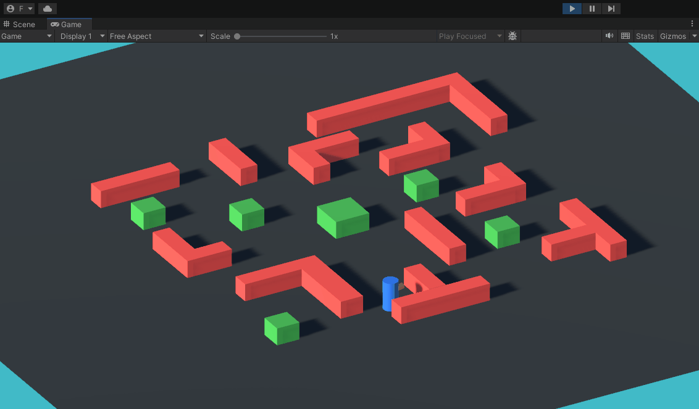
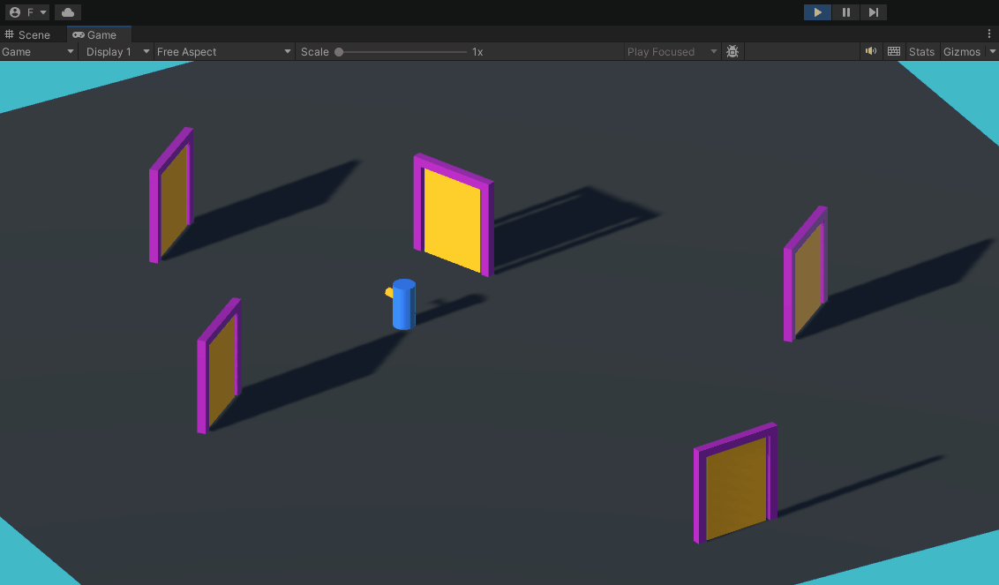
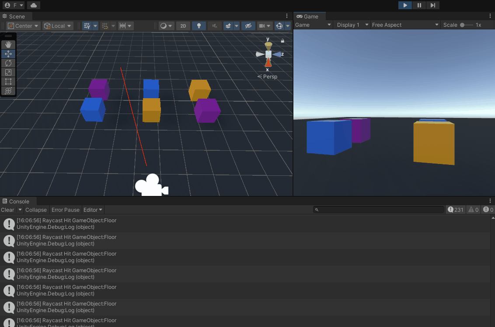
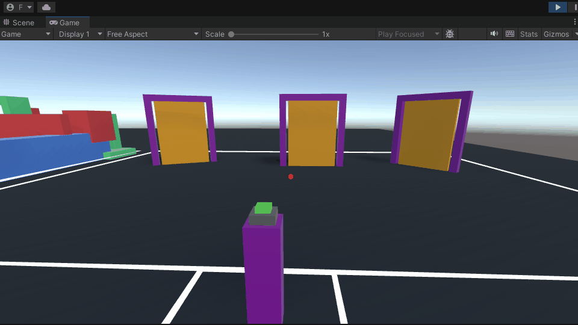
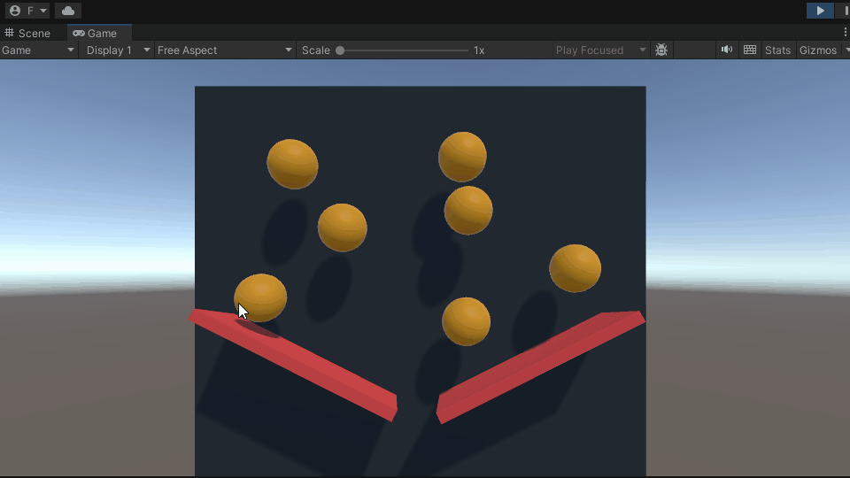

# Scripting Interactions

An introduction to the main concepts associated with scripting interactions in Unity are covered in [this](https://youtube.com/playlist?list=PLk0p6RIhmcfkfKKCWE-4T7lGyiatcqxay) YouTube playlist.

In this page you can find an overview of the [project contents](#project-material) seen in the videos. 

## Project Material

All the videos refer to scenes and scripts contained in the "Assets/\_Scripting" folder.

- [06-OnCollision](#06-oncollision)
- [07-OnTrigger](#07-ontrigger)
- [08-Raycasting](#08-raycasting)
- [09-EnvironmentInteraction-FP](#09-environmentinteraction-fp)
- [10-EnvironmentInteraction-ScreenRay](#10-environmentinteraction-screenray)

### 06-OnCollision

### 07-OnTrigger

### 08-Raycasting

### 09-EnvironmentInteraction-FP

### 10-EnvironmentInteraction-ScreenRay

