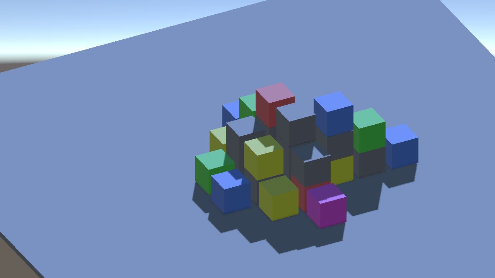
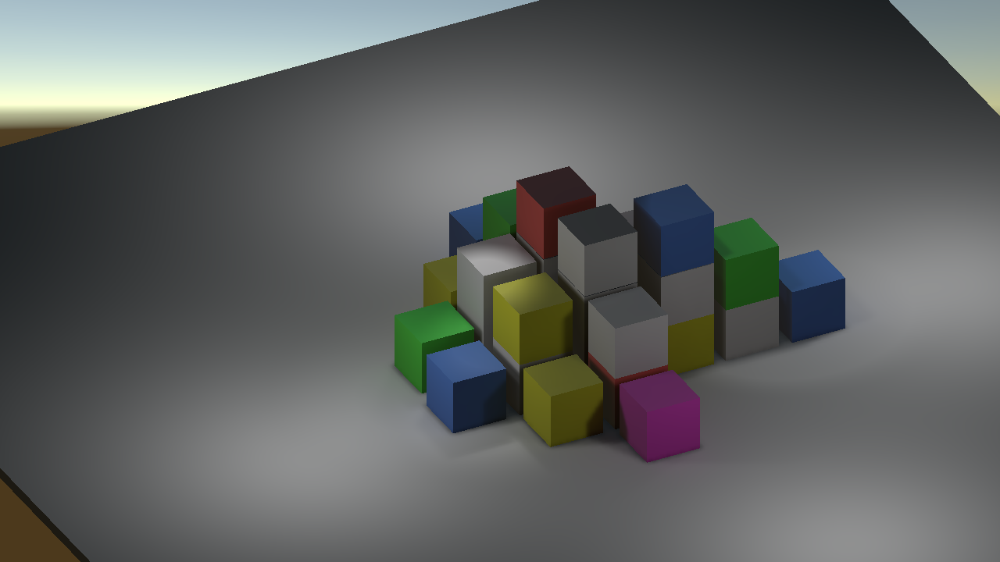
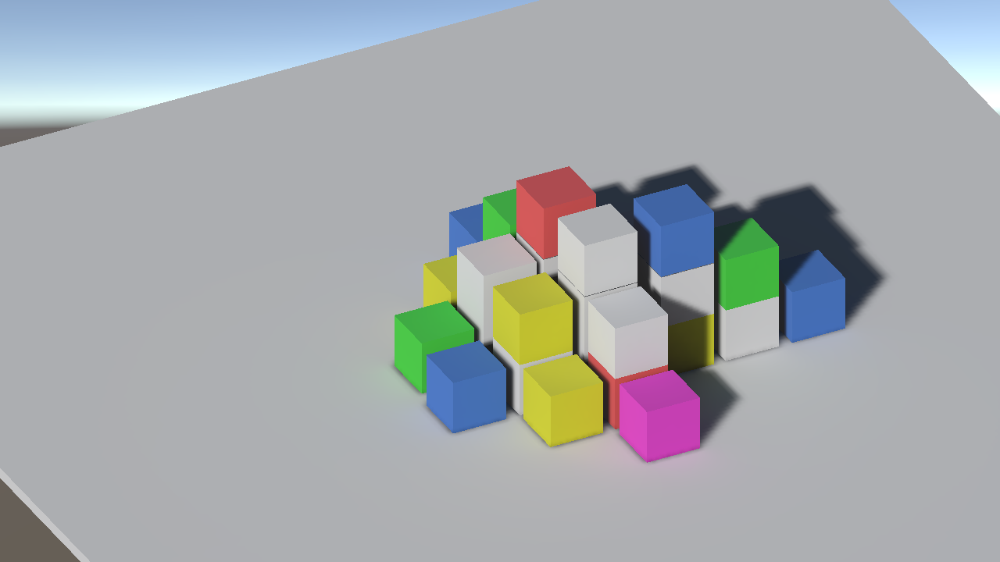
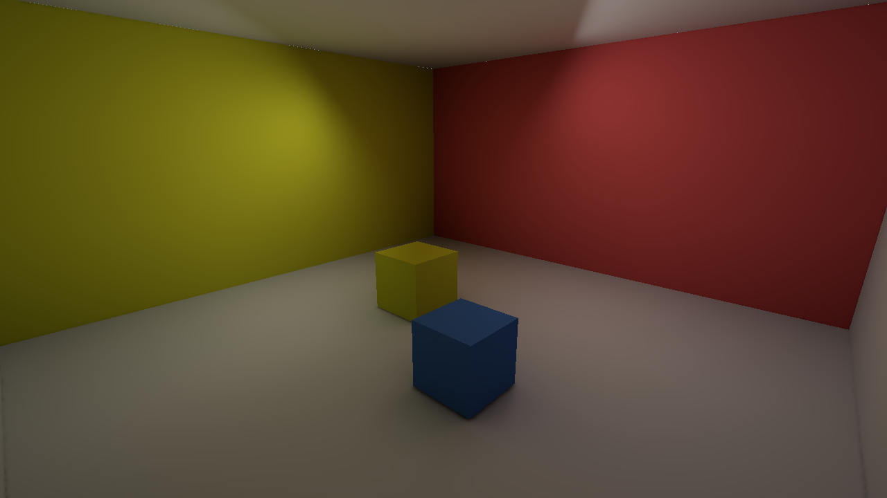
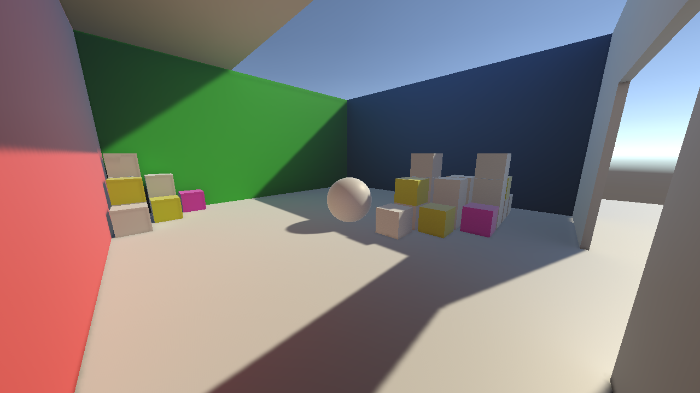
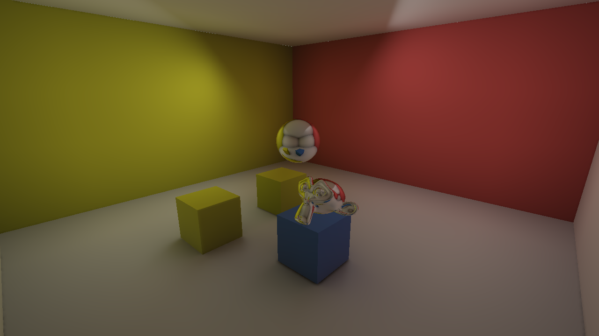
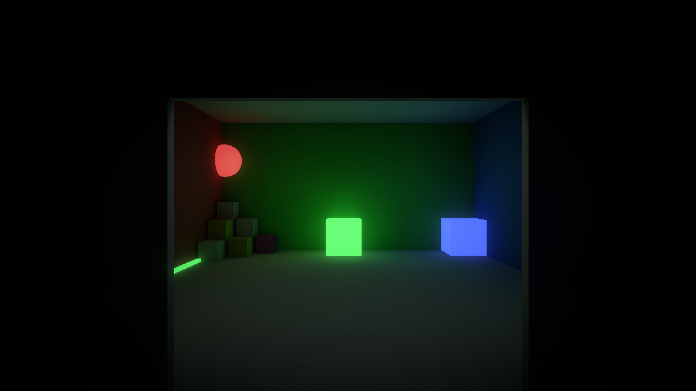
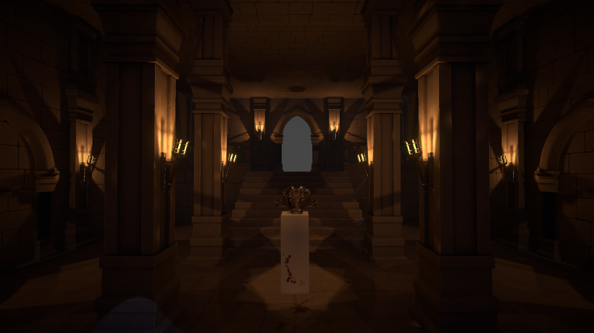

# Rendering, Lighting & VFX

This page is an overview of the project material about **lighting and rendering** in Unity: realtime and baked lights, light and reflection probes, emissive materials and post-processing. The **VFX** material will be added to this page later.

On this page you can find the [legacy scenes](#project-material) that go with the videos and a [worked example](#worked-example-the-dungeon) that combines everything in a single environment.

> **Note:** the videos were recorded with the Built-in Render Pipeline, while the project now targets **Unity 6.3** and the **Universal Render Pipeline (URP)**. The scenes keep the names used in the videos, but a few things changed with the conversion:
>
> - The materials were converted to the URP *Lit* shader. The default URP material is a mid grey, which dulls the **color bleeding** (the light that bounces off a colored surface and tints its neighbours), so the neutral surfaces of the baked scenes use the `white` material of `Assets/_Graphics/Materials`.
> - Every baked scene was baked again with the **Progressive GPU** lightmapper at **40 texels per unit**, 32 direct and 512 indirect samples, 4 bounces and the **OpenImageDenoise** denoiser, which keeps the lightmaps clean without long bake times.
> - The light probes of `02_LightProbes` use the URP **Adaptive Probe Volumes**, and the post-processing of `04_Emmissive_PostPorcess` was rebuilt with the URP **Volume** framework, since neither the manual Light Probe Group nor the old *Post Processing Stack* work with the URP settings of the project.
> - The `metal` material of `03_ReflectionProbes` is now fully metallic, so that the reflections of the probe are clearly visible.

## Where are the scenes?

| Scenes | Folder | What they are |
| --- | --- | --- |
| `00` to `04` | `Assets/_Graphics/Scenes` | The **legacy scenes** used in the videos, one concept at a time. |
| `graphics-dungeon` | `Assets/_v2/_Graphics/Scenes` | The **worked example**: a single environment that uses all the concepts together. |
| `A2-Environment`, `A2-Lighting` | `Assets/_v2/_Assignments/assignment-2/Scenes` | The **same dungeon split in two scenes**, as requested in assignment 2 ([see below](#from-the-dungeon-to-assignment-2)). |

## Project Material

All the videos refer to the scenes contained in the "Assets/\_Graphics" folder. To bake a scene use **Window > Rendering > Lighting > Generate Lighting**.

- [00_RealtimeLights](#00_realtimelights)
- [01_BakedLights](#01_bakedlights)
- [02_LightProbes](#02_lightprobes)
- [03_ReflectionProbes](#03_reflectionprobes)
- [04_Emmissive_PostPorcess](#04_emmissive_postporcess)

### 00_RealtimeLights

The starting point: a group of colored cubes on a plane, lit only by **realtime** lights. Nothing is baked in this scene. Realtime lights compute **direct light** only: the shadowed faces are lit just by the ambient light of the sky, and a colored cube does not tint the objects next to it.

The scene also contains a `PointLights` and a `SpotLights` group, disabled by default. Enable them in the Hierarchy to see how the other realtime light types behave, and compare the result with the next scene, where the same lights are baked.

### 01_BakedLights

Three scenes (`01_BakedLights_00`, `01_BakedLights_01` and `01_BakedLights_02`) that show what changes when the light is **baked** into lightmaps. For an object to receive baked light it must be marked as **Contribute GI** (static); the lights are set to *Baked* or *Mixed* in their **Mode** property.

- **`01_BakedLights_00`**: the same cubes as before, now lit by four *Baked* point lights and three *Mixed* spot lights. A baked light costs nothing at runtime and also produces **indirect light**, so you can see the color bleeding between the cubes and the floor. A mixed light keeps a realtime component (the direct light and its shadows), while its indirect contribution is baked.

  

- **`01_BakedLights_01`**: a single *Baked* directional light, with the corner cubes of the `Environment` group. Notice the soft shadows stored in the lightmap and the light that bounces off the colored cubes onto the floor.

  

- **`01_BakedLights_02`**: a room with colored walls lit by two *Baked* **area lights**. Area lights are always baked: they have no realtime counterpart. Look at how the yellow and the red walls tint the floor and the cubes.

  

For more details see the Unity manual pages about [light modes](https://docs.unity3d.com/6000.3/Documentation/Manual/LightModes-introduction.html) and the [Lighting window](https://docs.unity3d.com/6000.3/Documentation/Manual/lighting-window.html).

### 02_LightProbes

Baked light is stored in lightmaps, which only **static** objects can use. Objects that move need another way to receive the baked light: **light probes**. This scene has a mixed directional light, static walls with openings and a probe volume that covers the whole room. A moving object samples the probes closest to it and gets a plausible lighting that follows the colors of the room: look at the pinkish tint of the cubes and of the sphere close to the red wall.

In the videos the probes are placed by hand with a **Light Probe Group**. The URP of Unity 6.3 is set to use **Adaptive Probe Volumes** (*Lighting > Light Probe System* in the `URP_Asset`), which place the probes automatically: the scene contains an `Adaptive Probe Volume` object instead of the Light Probe Group. Select it, and see its probes with **Window > Rendering > Lighting > Adaptive Probe Volumes** (enable *Display Probes* in the Rendering Debugger). Move the sphere around and compare how it is lit inside and outside the room.

For more details see the Unity manual page about [Adaptive Probe Volumes](https://docs.unity3d.com/6000.3/Documentation/Manual/urp/probevolumes.html).

### 03_ReflectionProbes

Light probes carry the *diffuse* light. The *specular* reflections of a shiny surface need a **Reflection Probe**, which captures the surrounding environment in a cubemap that the reflective objects sample. In this scene a probe is placed in the middle of the room and baked together with the two area lights: the sphere and the monkey head, which use the `metal` material, reflect the walls, the cubes and the lights.

Try moving the probe, or resizing its box, and bake again: the objects only use the probe when they are inside its volume.

### 04_Emmissive_PostPorcess

A dark room with **emissive** materials (`emissive_red`, `emissive_green`, `emissive_blue` and `emissive_white`). An emissive surface that is marked as **Contribute GI** is baked as if it were a light: look at the colored glow that the cubes and the sphere cast on the walls and on the floor.

The glow of the emissive objects and the dark borders of the image come from the **Post-process Volume**. In URP the post-processing is driven by a **Volume** component with a profile (`PostProcessingProfiles/NightPPProfile_URP`) that overrides the **Bloom** and **Vignette** effects, and by the *Post Processing* option of the camera. Change the Bloom *Intensity* and *Threshold* in the profile to see how they affect the emissive surfaces.

## Worked example: the dungeon

The scene `graphics-dungeon` (in `Assets/_v2/_Graphics/Scenes`) is a complete environment that puts together what the previous scenes show separately. It is a good scene to explore after the videos, and a reference for what is asked in the assignments.

- **Baked lights**: the twelve *Baked* point lights are the torches on the walls, while a dim bluish *Mixed* directional light acts as the moonlight that enters from the openings.
- **Adaptive Probe Volume**: the probes that give the baked light to the moving objects.
- **Reflection Probe**: baked, and used by the monkey head on the pedestal.
- **Decals**: four **Decal Projectors** paint the blood stains (`blood-decal-1`, `-2` and `-3`) on the floor and on the pedestal without changing the geometry. Decals need the **Decal** renderer feature, enabled in the `URP_Renderer` asset.
- **Post-processing**: a global **Volume** (`dungeon-volume-profile`) with Bloom and Vignette.

### Modular assets and prefabs

The environment is built from the **modular pieces** of the Dungeon Modular Pack (walls, tiles, pillars, arches, steps, handrails and torches): few reusable pieces, set up as **prefabs**, placed on a grid. This is the same approach asked in assignment 2.

### The custom shader

The materials of the pack do not use the URP *Lit* shader, but a **Shader Graph** (`DungeonKitShader`). The reason is the texture packing: the pack stores ambient occlusion, roughness and metalness in the three channels of **one** texture (an **ORM** texture, *Occlusion-Roughness-Metallic*), a common layout in Unreal Engine and glTF. The URP *Lit* shader expects a different layout: metalness in the red channel and smoothness in the alpha channel of one texture, and the occlusion in a separate one, with *smoothness* instead of *roughness*. The graph reads the ORM texture once, sends each channel to the right input and inverts the roughness to obtain the smoothness. It also exposes a multiplier for each of the three values and an emission switch.

When you pack your own textures, remember that the layout must match the shader that will read them.

### From the dungeon to assignment 2

The two scenes `A2-Environment` and `A2-Lighting` (in `Assets/_v2/_Assignments/assignment-2`) are the dungeon **split in two**, to show the setup requested in assignment 2:

- `A2-Environment` contains the environment: the modular prefabs, the decals and the camera.
- `A2-Lighting` contains the lighting: the torch lights, the directional light, an **area light** placed in the left arch as a moonlight window, the reflection probe and the volume.

Baking with multiple scenes follows a few rules: both scenes must be open together, and the lighting data is saved against the **active scene**, so the lighting scene must be the active one when you bake. The small script [`LightingSceneLoader`](https://github.com/francescoStrada/Unity-Course-Lectures/blob/main/Unity-Course-Lectures/Assets/_v2/_Assignments/assignment-2/Scripts/LightingSceneLoader.cs) takes care of it: add it to any GameObject of the environment scene and click the button in its Inspector to load the lighting scene and make it active. The Inspector also tells you when it is safe to bake, and when you press **Play** from the environment scene the script loads the lighting scene for you. For the details see the Unity manual page [Bake data in multiple scenes](https://docs.unity3d.com/6000.3/Documentation/Manual/bakemultiplescenes.html).

## Credits

<blockquote class="callout callout_default" theme="">

The dungeon is built with the <a href="https://assetstore.unity.com/packages/3d/environments/dungeons/dungeon-modular-pack-295430"><b>Dungeon Modular Pack</b></a>, a third-party asset from the Unity Asset Store (pieces, materials, textures and the <code>DungeonKitShader</code> Shader Graph). It is placed in <code>Assets/External/DungeonModularPack</code>. It is not part of this course material: it is subject to the license of its Asset Store page, which you should check before reusing it in your own projects.
 </blockquote>
