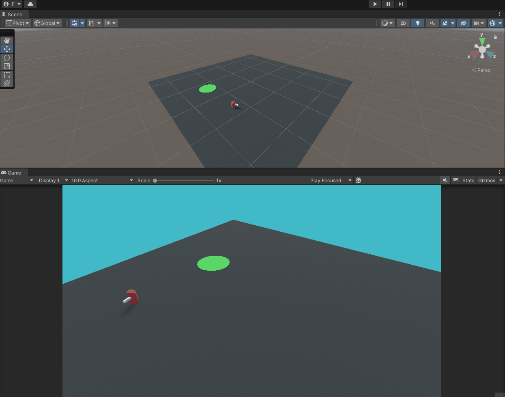
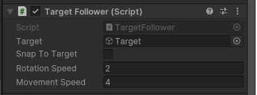
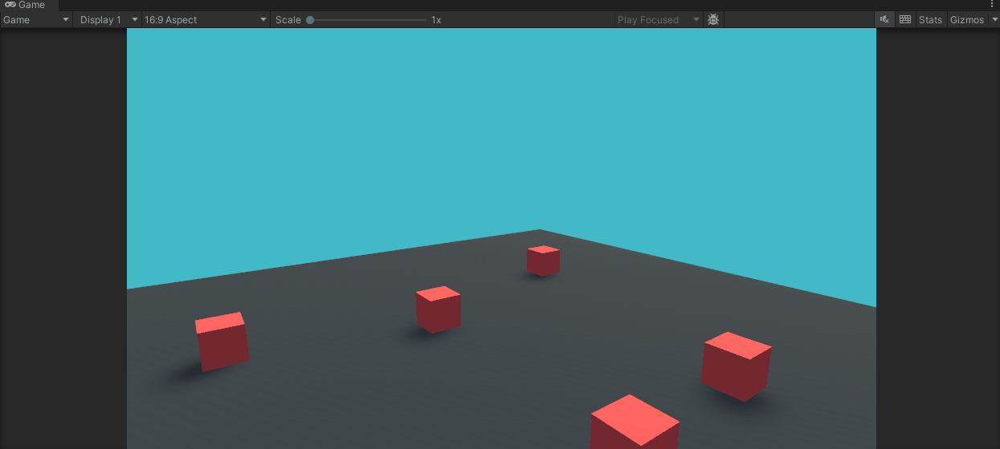
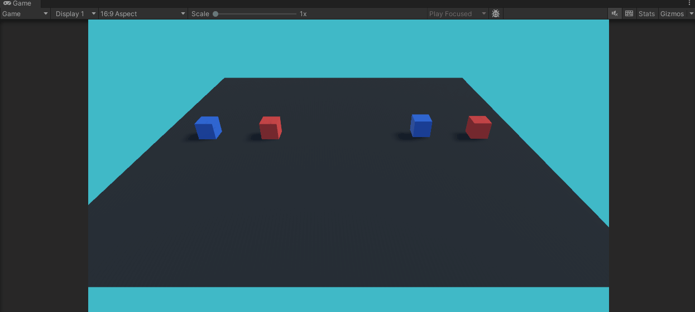

# Scripting

An introduction to the main concepts associated with Scripting are covered in [this](https://youtube.com/playlist?list=PLk0p6RIhmcflK_474ACvIo4MsL6yl-09b) YouTube playlist.

On this page, you can find an overview of the [project contents](#project-material) seen in the video.

> **Note:** the videos were recorded with Unity 2019.4, while the project now targets **Unity 6.3** and the **Universal Render Pipeline (URP)**. Scenes, scripts and GameObjects keep the names used in the videos. The legacy `Input` class used in the videos is deprecated, so the scripts now use the new [Input System](https://docs.unity3d.com/Packages/com.unity.inputsystem@1.20/manual/index.html): every replaced line is kept as a comment directly above its new version, so you can follow the videos and see how each old call maps onto the new API.

## Project Material

All the videos refer to scenes and scripts contained in the "Assets/_Scripting" folder.  

- [00-Callbacks-Debug](#00-callbacks-debug)
- [01-TargetFollower](#01-targetfollower)
- [02-DeltaTime](#02-deltatime)
- [03-Keyboard-GetKey](#03-keyboard-getkey)
- [04-KeyBoard-Input-Movement](#04-keyboard-input-movement)
- [05-Camera-Independent-Movement](#05-camera-independent-movement)

### 00-Callbacks-Debug

This scene simply contains a red cube with a script attached to it that prints to the editor console, using the Debug.Log(), the different [Unity callbacks](https://docs.unity3d.com/Manual/ExecutionOrder.html).  

An even more detailed description on the execution order of Unity callbacks can be found in [this Unity thread](https://forum.unity.com/threads/a-comprehensive-guide-to-the-execution-order-of-unity-event-functions.1381647/)
### 01-TargetFollower



This scene shows a following behaviour scripted in the file, *TargetFollower.cs*. The MonoBehaviour collects the referenced object from the Target property in the script and then follows rotating and moving according to the other properties of the script. If no Target is assigned in the Inspector, the script searches the scene for the object carrying a `SimpleTarget` component with [FindAnyObjectByType()](https://docs.unity3d.com/ScriptReference/Object.FindAnyObjectByType.html), which replaces the now deprecated `FindObjectOfType()` seen in the video. Searching by component is more reliable than searching by GameObject name or tag.



### 02-DeltaTime

This scene simply shows the importance of using the property [Time.deltaTime](https://docs.unity3d.com/ScriptReference/Time-deltaTime.html) when moving objects during runtime. The red cube ignores it and shoots away, while the blue cube uses it and moves at a constant speed. The proper usage of this property ensures to have an application which is not frame-dependent (i.e., the objects' behaviour is not affected by the framerate the application is capable to run on a given hardware).

A further explanation of this concept, and other examples are detailed also in [this](https://docs.unity3d.com/Manual/TimeFrameManagement.html) Unity manual page.

### 03-Keyboard-GetKey



This scene shows how to detect input from single keys of the keyboard and act accordingly: Space changes the color of the cubes, S spawns new cubes at random positions and D destroys them all.

The video uses the legacy [Input](https://docs.unity3d.com/ScriptReference/Input.html) class and its [GetKey()](https://docs.unity3d.com/ScriptReference/Input.GetKey.html), GetKeyDown() and GetKeyUp() functions. With the new Input System, single keys are read directly from the keyboard device: `isPressed` corresponds to GetKey(), `wasPressedThisFrame` to GetKeyDown() and `wasReleasedThisFrame` to GetKeyUp(). `Keyboard.current` is null when no keyboard is connected, so it is checked first:

```csharp
using UnityEngine.InputSystem;
...
Keyboard keyboard = Keyboard.current;
if (keyboard == null)
    return;

// Legacy Input (as in the videos):
// if(Input.GetKeyDown(KeyCode.Space))
if (keyboard.spaceKey.wasPressedThisFrame)
    ChangeColor();
```

In this action the example is very simple: the color of each cube is randomly assigned, using the [Random](https://docs.unity3d.com/ScriptReference/Random.html) class:

```csharp
private Color[] _colors = new[] {Color.red, Color.blue, Color.green, Color.magenta, Color.white, Color.cyan, Color.yellow, Color.black};

private void ChangeColor()
{
    if(_renderer == null)
        return;
    _renderer.material.color = _colors[Random.Range(0, _colors.Length)];
}

```

### 04-KeyBoard-Input-Movement



This scene demonstrates how to read directional input from either WASD or arrow keys. The cubes on the left have their movement continuously updated in order to maintain changes. The cubes on the right are translated from their original starting position based on the input read either through Input.GetKey() or Input.GetAxis(). This is to show how the input read through the first method is simply a boolean which can be either true or false. On the contrary, using the GetAxis() method the read input gradually increases and decreases from one of the extremes -1 or 1 to the rest value of 0.    

Further details on the GetAxis() function can be found in the [documentation page](https://docs.unity3d.com/ScriptReference/Input.GetAxis.html) or in [this](https://www.youtube.com/watch?v=MK4OmsViqMA) YouTube video.  

With the new Input System, the GetKey() scripts read the keys with `isPressed`, as in the previous scene. The axes, instead, are replaced by an [Input Action](https://docs.unity3d.com/Packages/com.unity.inputsystem@1.20/manual/Actions.html): the project-wide actions asset (*Assets/InputSystem_Actions.inputactions*) defines a *Player/Move* action, bound to WASD and the arrow keys, which returns a `Vector2`. Just as "Horizontal" and "Vertical" were defined once in the Input Manager, *Move* is defined once in the asset, and each script receives it through an `InputActionReference` assigned in the Inspector:

```csharp
public InputActionReference moveAction;
...
// Legacy Input (as in the videos):
// float h = Input.GetAxis("Horizontal");
// float v = Input.GetAxis("Vertical");
Vector2 move = moveAction.action.ReadValue<Vector2>();
float h = move.x;
float v = move.y;
```

An Input Action returns the raw input, without the gradual increase and decrease of GetAxis(). To keep the comparison visible, *AxisInput.cs* rebuilds that behaviour in code: its `Ease()` method moves the value towards the input at `sensitivity` units per second, back to rest at `gravity` units per second, and snaps to 0 when the direction is reversed, like the corresponding settings of the Input Manager.

### 05-Camera-Independent-Movement

This scene contains four cameras, placed on the four sides of the scene; pressing Space cycles through them (*CameraSwitcher.cs*). Two cubes are moved with the same *Move* input (*CameraIndependentMovement.cs*), but in two different ways:

- the **purple** cube moves along the world axes, so the same key moves it in a different direction on screen depending on the active camera;
- the **green** cube has *CameraOrientationIndependent* ticked: the input direction is converted from the active camera's space to world space with [TransformDirection()](https://docs.unity3d.com/ScriptReference/Transform.TransformDirection.html), so W always moves it away from the viewer and D always to the right, whichever camera is active.

The FORWARD and RIGHT labels on the ground always face the active camera (*LookTowardsActiveCamera.cs*), which finds every camera of the scene with [FindObjectsByType()](https://docs.unity3d.com/ScriptReference/Object.FindObjectsByType.html) and follows the one that is enabled.
